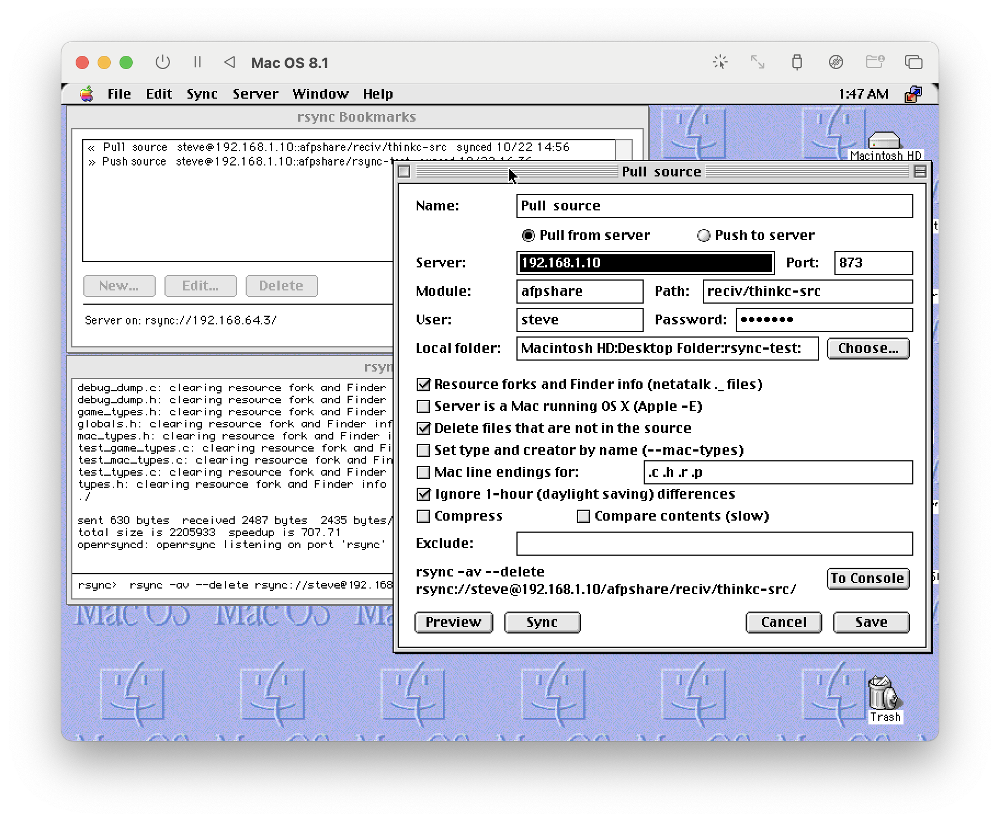

# rsyncope

rsyncope is a port of `openrsync` (Apple's current rsync, protocol 29) to Classic Mac OS, built with [Retro68](https://github.com/autc04/Retro68). It transfers files to or from an rsync daemon and keeps resource forks and Finder info. Only changed files are sent, which is much faster and less-error prone than syncing files by hand.

## Overview

rsyncope was built to streamline a development workflow for building macOS applications:
1. Edit files in a modern editor such as VSCode
2. Copy (rsync) the files to a classic macOS environment like a VM to be compiled with a native
compiler like THINK C

With the app's `rsyncd` server running in the classic macOS environment, files can be sent from the host
to the VM from a makefile or script, e.g.:
`rsync -av -E thinkc-src rsync://192.168.64.3/incoming/`

There are two applications in the distribution:

* **rsyncope**, the windowed app (`classic/gui`):
  * **rsync Bookmarks:** one window listing your saved syncs, like an FTP client's bookmarks. New… creates one. Double-clicking (or Edit…) opens it for review. Sync runs it, and Preview does a dry run.
  * **The editor window:** has every option, a Choose… folder button, the equivalent command line, and To Console, which copies that command to the console.
  * **rsync Console:** the command line, with history on the Up and Down arrows. `help` lists the built-ins: `bookmarks`, `sync NAME`, `preview NAME`, `server on|off`, `set`, `trace`, `memory`, `clear`, `quit`.
  * **The server:** starts at launch when an `rsyncd.conf` is next to the app (Server > Start Server at Launch turns that off). A sync started from the GUI pauses the server between connections, and it resumes afterwards.
  * **Storage:** bookmarks are kept in the text file `rsync Bookmarks` next to the app.
* **rsync console**, the same engine with only a console window (`classic/rsync`). It's used for scripting and the emulator tests.

See [`classic/USAGE.md`](classic/USAGE.md) for command-line examples, daemon setup, resource-fork behavior, and netatalk setup.

## Requirements

* A 68k Classic Mac running Mac OS 7.1 or greater and MacTCP
* An rsync daemon for remote transfers; ssh and rsync-over-ssh are not supported

Real hardware and performance have not yet been tested.

## Security

**Transfers are not secure.** The Classic Mac build supports only rsync-daemon connections, not ssh. The rsync daemon protocol sends file data and transfer metadata over the network without transport encryption. A daemon password may restrict access, but it does not protect the data while it is in transit.

Use rsync only over a trusted network or a separately secured tunnel/VPN. Prefer `read only = yes` for modules that do not need writes, restrict daemon access with a firewall or host allowlist, and do not transfer secrets over an untrusted network.

## Development

For information on project layout, building, and testing, see [`docs/DEVELOPMENT.md`](docs/DEVELOPMENT.md).

## Status

Working in QEMU q800 with Mac OS 8.1, against rsync 3.2.7:
* pull with resource forks and Finder info
* a second run transfers nothing
* fork-only and data-only changes are re-sent separately
* `--delete`
* MacRoman and long file names

Also working, in QEMU and in the host tests: host names via MacTCP DNR, `--mac-types`, `--mac-text`, and DST tolerance (checked on the Mac by shifting the clock an hour with `set RSYNC_GMT_OFFSET`).

Known issues:
* **Pushing resource forks:** Pushing a file that contains a resource fork to a non-macOS host may fail to set the correct file attributes on that file, resulting in netatalk or other clients being unable to read the resource fork.

Not done yet:

* **Local copies** (two Mac paths, e.g. from a mounted AFP volume) need a thread-based server (plan §3.6).
* **ssh support** rsync-over-ssh is not supported for either the client or server.
* **Real hardware.** Not yet run on a classic Mac, and speed has not been measured.
* **Repeated commands.** Several commands in one session reset getopt, verbosity and filter rules. Other global state in openrsync may still carry over, so if a second command misbehaves, quit and relaunch.
